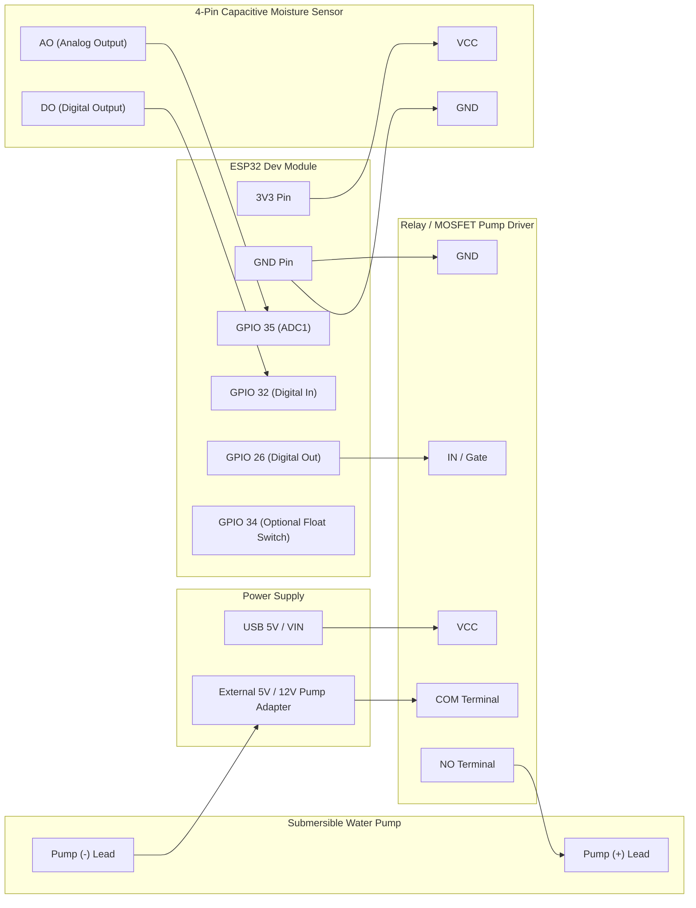
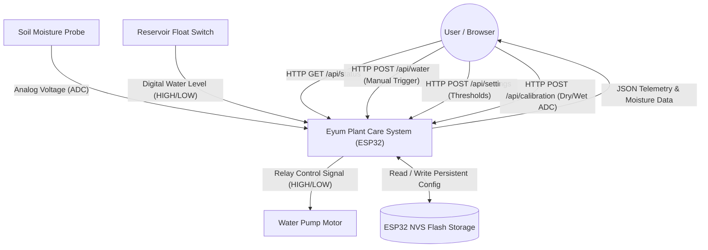
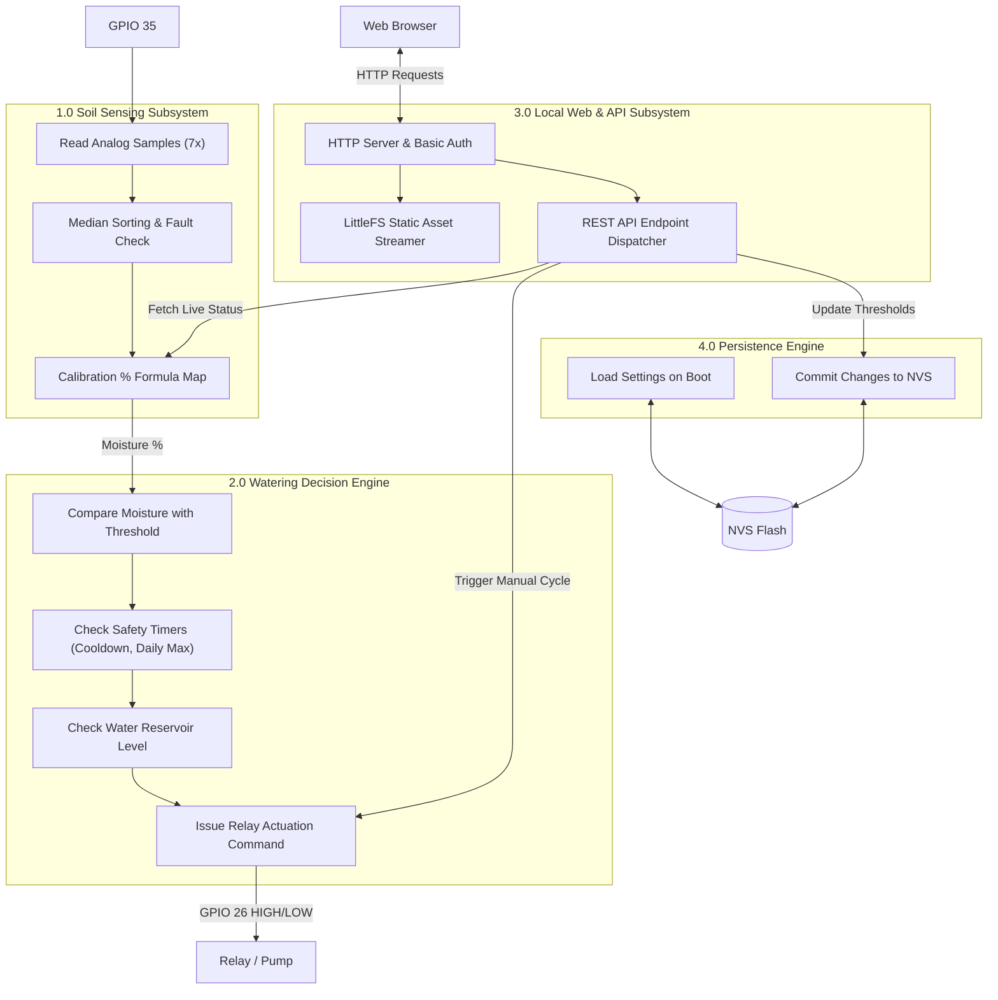
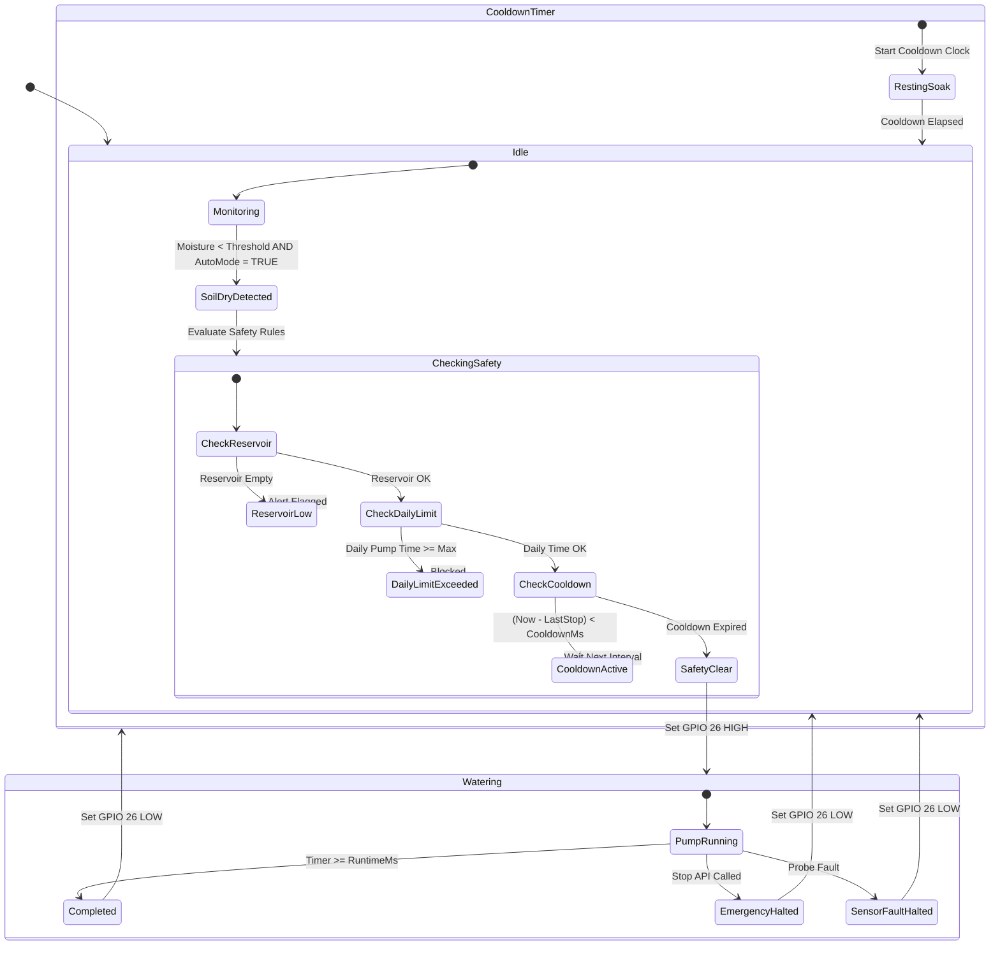
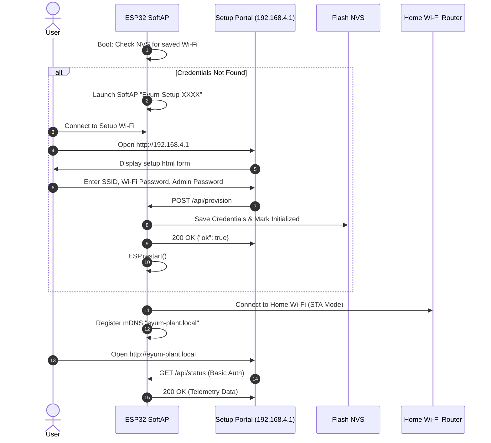

# Eyum Plant Care - System Architecture & Engineering Documentation

## 1. System Overview

**Eyum Plant Care** is an autonomous, local-first IoT irrigation and soil monitoring system powered by an **ESP32 microcontroller**. It operates completely independently of external cloud services or internet dependencies, executing sensor reading, flood prevention safety algorithms, and local web serving directly on the chip.

```
+-----------------------------------------------------------------------------------+
|                              LOCAL BROWSER / CLIENT                               |
|                     (Light Botanical UI · SVG Moisture Gauge)                     |
+-----------------------------------------+-----------------------------------------+
                                          | HTTP / JSON REST & WebSockets (Port 80)
                                          v
+-----------------------------------------------------------------------------------+
|                                ESP32 CONTROLLER                                   |
|                                                                                   |
|  +--------------------+  +--------------------+  +-----------------------------+  |
|  |     WebServer      |  |   LittleFS Flash   |  |        ESP-mDNS             |  |
|  |  (REST API + CORS) |  | (HTML/CSS/JS Assets)|  |   (eyum-plant.local)        |  |
|  +---------+----------+  +---------+----------+  +--------------+--------------+  |
|            |                       |                            |                 |
|            +-----------------------+----------------------------+                 |
|                                    |                                              |
|  +---------------------------------+-------------------------------------------+  |
|  |                       Core Application Engine                               |  |
|  |  +-------------------+  +--------------------+  +------------------------+  |  |
|  |  |  MoistureSensor   |  | WateringController |  |     SettingsStore      |  |  |
|  |  | (Median Filtered) |  | (Safety & Limits)  |  |  (ESP32 NVS Storage)   |  |  |
|  |  +---------+---------+  +---------+----------+  +------------+-----------+  |  |
|  +------------|----------------------|--------------------------|--------------+  |
+---------------|----------------------|--------------------------|-----------------+
                |                      |                          |
                v                      v                          v
       Capacitive Probe           Pump MOSFET / Relay        Flash EEPROM (NVS)
        (GPIO 35 / 32)                (GPIO 26)             (Wi-Fi & Calibration)
```

---

## 2. Hardware Wiring Schematic



### Complete Pin Assignment Table

| Function | Pin Name | Physical Pin | Electrical Spec | Description |
| :--- | :--- | :--- | :--- | :--- |
| **Soil Moisture Analog** | `SOIL_PIN` | **GPIO 35** | Input only, ADC1, 0–3.3V | 12-bit ADC reading with 7-sample median filter. |
| **Soil Moisture Digital** | `SOIL_DO_PIN` | **GPIO 32** | Input, 3.3V logic | Optional digital threshold trigger from sensor potentiometer. |
| **Pump Output** | `PUMP_PIN` | **GPIO 26** | Output, 3.3V logic | Active-HIGH signal to relay or N-channel MOSFET gate. |
| **Reservoir Float Switch** | `RESERVOIR_PIN` | **GPIO 34** | Input, pulled high | Active-LOW: LOW = Water OK, HIGH = Reservoir Empty. |

---

## 3. Data Flow Diagrams (DFD)

### Level 0 DFD: Context Diagram



### Level 1 DFD: Subsystem Process Decomposition



---

## 4. State Machine & Workflow Diagrams

### 4.1. Autonomous Irrigation Lifecycle



### 4.2. First-Run Wi-Fi Provisioning Flow



---

## 5. Memory & NVS Storage Schema

Settings are saved in the ESP32 Non-Volatile Storage (NVS) using `Preferences.h` under the namespace `"eyum"`:

| NVS Key | Type | Default Value | Description |
| :--- | :--- | :--- | :--- |
| `dry` | `int32` | `3000` | ADC reading representing 0% moisture (bone-dry soil). |
| `wet` | `int32` | `1500` | ADC reading representing 100% moisture (saturated soil). |
| `threshold` | `uint8` | `30` | Auto-mode watering threshold (triggers below this %). |
| `runtime` | `uint32` | `3000` (ms) | Single pump cycle runtime in milliseconds. |
| `cooldown` | `uint32` | `300000` (ms)| Rest time after watering (default 5 minutes). |
| `soak` | `uint32` | `30000` (ms) | Minimum soak absorption delay. |
| `daily` | `uint32` | `30000` (ms) | Maximum cumulative pump runtime in 24 hours (30s). |
| `auto` | `bool` | `false` | Autonomous irrigation enable flag. |
| `ssid` | `string`| `""` | Home Wi-Fi network name. |
| `wifiPass`| `string`| `""` | Home Wi-Fi network password. |
| `dashPass`| `string`| `""` | Administrator dashboard password. |
| `initialized`| `bool`| `false` | First-run provisioning completion flag. |

---

## 6. REST API Specification

All endpoints support HTTP Basic Authentication (Username: `admin`, Password: user-configured) and return standard CORS headers (`Access-Control-Allow-Origin: *`).

### 6.1. `GET /api/status`
Returns real-time telemetry, sensor readings, and actuator states.

```json
{
  "valid": true,
  "raw": 2415,
  "moisture": 42,
  "fault": "",
  "digitalTrigger": 1,
  "pump": false,
  "remainingMs": 0,
  "auto": true,
  "lastStop": "completed",
  "reservoirOk": true,
  "uptimeSec": 4320,
  "rssi": -62,
  "ip": "192.168.29.60",
  "mdns": "eyum-plant.local"
}
```

### 6.2. `POST /api/water`
Triggers an immediate safety-limited manual watering cycle.
- **Request Body**: `{}`
- **Response**: `200 OK {"ok": true}` or `409 Conflict {"error": "Pump already running"}`

### 6.3. `POST /api/stop`
Immediately halts the pump and records stop reason as `"manual"`.
- **Request Body**: `{}`
- **Response**: `200 OK {"ok": true}`

### 6.4. `POST /api/auto`
Enables or disables autonomous threshold watering.
- **Request Body**: `{"enabled": true}`
- **Response**: `200 OK {"ok": true}`

### 6.5. `POST /api/settings`
Updates watering thresholds and safety limits.
- **Request Body**:
```json
{
  "threshold": 35,
  "pumpRuntimeMs": 3500,
  "cooldownMs": 180000,
  "soakMs": 30000,
  "maxDailyPumpMs": 45000
}
```
- **Response**: `200 OK {"ok": true}`

### 6.6. `POST /api/calibration`
Saves dry and wet ADC values for percentage interpolation.
- **Request Body**: `{"dryRaw": 3150, "wetRaw": 1420}`
- **Response**: `200 OK {"ok": true}`

---

## 7. Safety & Anti-Flooding Algorithms

1. **Anti-Hammering Cooldown**: After any watering cycle, a mandatory cooldown (default: 5 minutes) prevents the pump from triggering repeatedly before water has soaked down to root depth.
2. **24-Hour Rolling Pump Allowance**: A cumulative runtime accumulator tracks total pump activation time. If the pump exceeds `maxDailyPumpMs` (default: 30 seconds), all further auto and manual watering requests are blocked with `Daily watering limit reached`.
3. **Median Noise Rejection**: Sensor sampling takes 7 successive analog readings separated by 2ms delays, sorts them, and extracts the median sample (index 3). This discards high-frequency electrical noise from nearby motors or Wi-Fi bursts.
4. **Independent Manual Override**: Manual `Water Now` commands operate with safety timers, but are never blocked by uncalibrated sensors or cooldown delays, guaranteeing operator control during testing.
